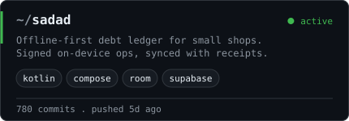
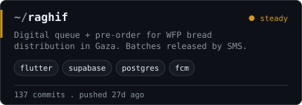
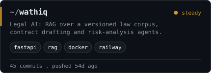
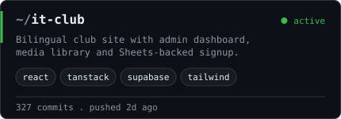
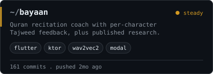
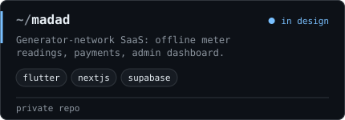
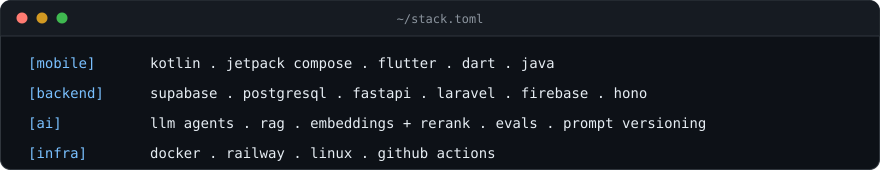
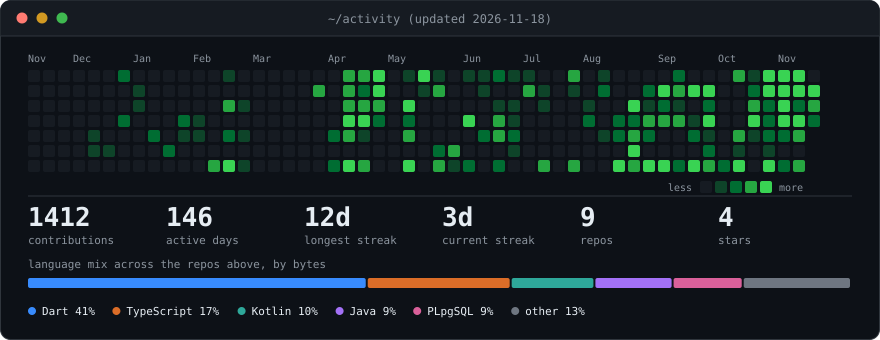

  

  <a href="https://www.linkedin.com/in/abdalrahman-elshiekh-khalil-461b963a2/">linkedin</a> &nbsp;·&nbsp;
  <a href="mailto:abdalrahman.py@gmail.com">email</a> &nbsp;·&nbsp;
  <a href="https://github.com/Abdalrahman-py?tab=repositories">repositories</a>

## Building now

<table>
  <tr>
    <td></td>
    <td></td>
  </tr>
  <tr>
    <td></td>
    <td></td>
  </tr>
  <tr>
    <td></td>
    <td></td>
  </tr>
</table>

## Stack

## Activity

Every image above is generated from the GitHub API by <a href="scripts/generate.mjs">scripts/generate.mjs</a> in a daily <a href=".github/workflows/profile.yml">GitHub Action</a>. No third-party image services, so nothing breaks when one is down.
